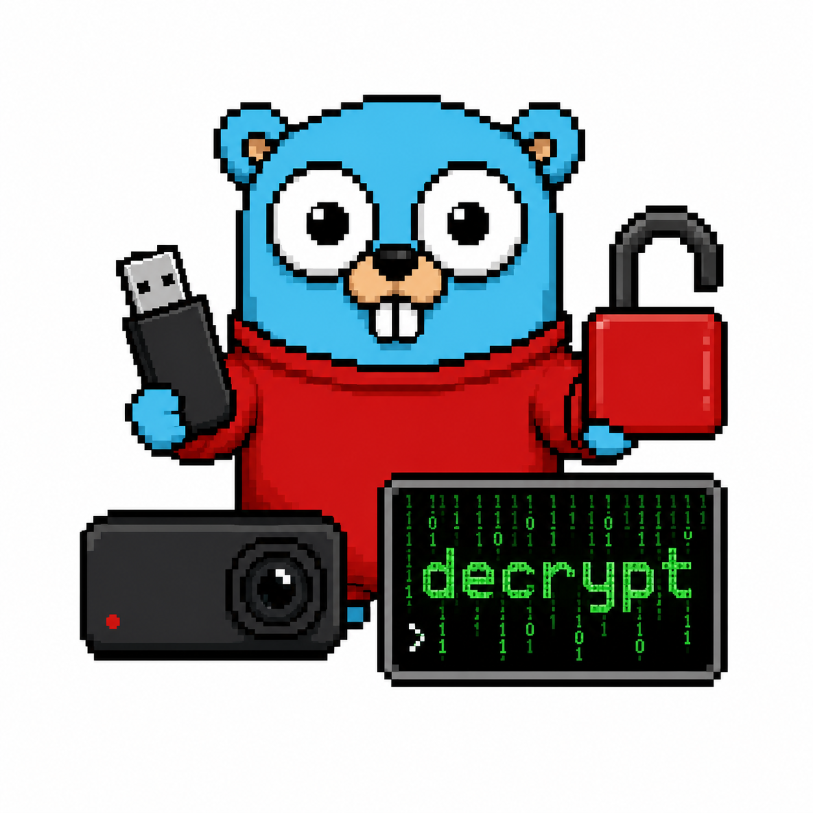

<p align="center">
  
</p>

<h1 align="center">tesdecrypt</h1>

[](https://github.com/crstian19/tesla-dashcam-decrypt-go/actions/workflows/ci.yml)
[](https://pkg.go.dev/github.com/crstian19/tesla-dashcam-decrypt-go)
[](LICENSE)

Batch-decrypt Tesla 2026.20+ encrypted dashcam clips, locally and in parallel.

From firmware 2026.20 Tesla encrypts dashcam and Sentry Mode recordings on the
USB drive. The official viewer at `dashcam.tesla.com` decrypts them one at a
time in the browser; this decrypts a whole drive in one command.

Your footage never leaves your machine. Only each clip's identifier and the
ownership metadata already present in its header are sent to Tesla to retrieve
that clip's key; the video is decrypted locally.

## Install

Download a binary from [releases](https://github.com/crstian19/tesla-dashcam-decrypt-go/releases),
or:

```sh
go install github.com/crstian19/tesla-dashcam-decrypt-go/cmd/tesdecrypt@latest
```

Or build from a checkout:

```sh
just build      # or: go build -o tesdecrypt ./cmd/tesdecrypt
```

## Usage

```sh
export TESLA_TOKEN="..."
tesdecrypt /run/media/$USER/TESLA/TeslaCam ~/Videos/TeslaCam
```

The output directory mirrors the layout of the drive, so `SentryClips/…` and
`SavedClips/…` keep their structure.

| Flag | Default | What it does |
|---|---|---|
| `--token` | `$TESLA_TOKEN` | Bearer token from dashcam.tesla.com |
| `--workers`, `-j` | CPU count | Clips decrypted in parallel |
| `--batch-size` | 20 | Clips per key request |
| `--skip-existing` | true | Skip clips already in the output directory |
| `--dry-run` | false | Fetch keys but write nothing |
| `--remux` | false | Losslessly remux each clip with ffmpeg |
| `--plain` | false | Plain output, no progress bar |

Output is a live progress view on a terminal and plain lines when redirected, so
it stays readable in a cron log. Decrypted files are written with mode `0600`
and their directories `0700`: the footage is yours.

Files in the input tree that were never encrypted, such as an ordinary MP4 you
already decrypted, are reported as skipped rather than as failures, so they do
not make the run exit non-zero. A clip that *is* encrypted but is damaged or
truncated is reported as a failure and produces no output at all.

### Getting a token

1. Open <https://dashcam.tesla.com> and sign in.
2. Open DevTools and select the Network tab.
3. Drop any encrypted clip onto the page.
4. Open any `/api/1/` request and copy the value after `Authorization: Bearer `.

Tokens expire, so grab a fresh one each session. Prefer `TESLA_TOKEN` over
`--token` to keep the token out of your shell history.

### Remuxing

`--remux` pipes each decrypted clip through `ffmpeg -c copy -movflags faststart`.
It is lossless and only rewrites the container, which helps players that dislike
Tesla's MP4 layout. It requires `ffmpeg` on `PATH`.

## How it works

Each clip is an encrypted container with two 4096-byte header pages followed by
the payload:

| Offset | Size | Field |
|---|---|---|
| `0x0000` | 8 | Plaintext MP4 size (uint64, big-endian) |
| `0x0004` | 16 | Correlation id, sent as the API item id |
| `0x0014` | 4 | Metadata offset (`0x1000`) |
| `0x1000` | 4 | `key_id` (uint32, big-endian) |
| `0x1004` | 65 | `public_key` (uncompressed EC point) |
| `0x1045` | 17 | VIN (ASCII) |
| `0x1056` | 8 | Timestamp (uint64, big-endian) |
| `0x105e` | 44 | `wrapped_key` |
| `0x2000`+ | rest | AES-128-CBC payload, 4096-byte pages |

The payload uses an eCryptfs-style scheme: AES-128-CBC over 4096-byte pages,
where each page derives its own IV and no IV is stored in the file.

```text
iv = MD5( MD5(file_key) + ascii(page_number) )      zero-padded to 32 bytes
```

The file key itself is not in the file. It is unwrapped by Tesla: the tool posts
the header's ownership metadata to `/api/1/decrypt/batch` and receives a
per-clip AES-128 key tied to the account.

### A note on the correlation id

The 16-byte id at offset `0x0004` overlaps the plaintext size field, so it
begins with the low half of that size and is followed by constant magic and
version words. It is **not** a UUID and it is **not** unique: two clips of
exactly the same byte size produce an identical id.

Since API results are matched to requests by that id, two colliding clips must
never share one request. `tesdecrypt` detects the collision and pushes the
second clip to a later batch, keeping the header it already read so no clip is
ever read from disk twice. (The Python implementation this was ported from keys
a dictionary on the id, so one of the two clips is silently dropped.)

### Wrong keys are caught, not written out

AES-CBC has no integrity check: under the wrong key a clip decrypts to
full-length noise rather than failing. After decrypting the first page
`tesdecrypt` checks for the `ftyp` box every MP4 opens with, and fails the clip
if it is missing. Otherwise a whole drive could decrypt to unplayable files while
the summary reported success.

## Development

```sh
just            # list recipes
just test       # go test -race ./...
just lint       # golangci-lint
just build      # build the binary
```

The container format is covered by a golden fixture encrypted with OpenSSL
rather than with this code, and the IV derivation is checked against vectors
computed independently, so the tests exercise the format rather than agreeing
with themselves. `internal/containertest` is the only place that writes the
layout, so a format change breaks one file.

`TESLA_API_BASE` overrides the API origin, which is how the end-to-end test
points the binary at a stub server. It must be HTTPS unless it is loopback, and
any override is announced on stderr, because your bearer token rides on every
request.

## Credits

Ported to Go from [XGxF3/tesla-dashcam-decrypt](https://github.com/XGxF3/tesla-dashcam-decrypt),
whose [write-up](https://github.com/XGxF3/tesla-dashcam-decrypt/blob/main/WRITEUP.md)
reverse-engineered the format. MIT, as is the original.

## License

MIT, see [LICENSE](LICENSE).
